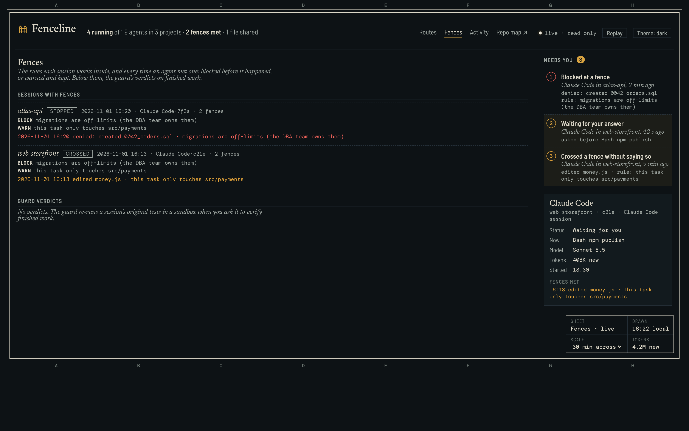

# Fenceline

**Watch and fence your coding agents.** A live dashboard of every Claude Code session and subagent, and a map of where
each one goes in the repo, with fences you write in plain English.


<sub>Replay (×3) of a real recorded Claude Code session (Haiku) from the runs in `evals/results/runs/`. Nothing on screen is mocked.</sub>

> "I gave Claude one rule: don't touch the migrations folder. Two hours into the session, it did. I only found out in review."

Telling the agent is one defence. Fenceline is the other: **tell the map.** You write the fence once, up front. Fenceline
compiles it into path globs you can read and edit. It then watches every read, edit and shell command, and flags or blocks
the moment the work leaves the area you meant. No LLM runs while the agent works.

```sh
claude plugin marketplace add tomtomsatnav/fenceline && claude plugin install fenceline@fenceline
```

Then start a new Claude Code session and open http://127.0.0.1:4318 for the dashboard. In Claude Code:

```
/fenceline:fence "migrations: off-limits" "this task only touches src/payments"
/fenceline:map
```

## The dashboard


<sub>Synthetic demo data (`dashboard/scripts/demo-state.mjs`): every name is fictional.</sub>

Every session and subagent on your machine, live, drawn as a survey sheet: each agent is a route along a time scale,
subagents branch off the session that started them, fences sit on the route where an agent met them, and two agents that
touched the same file are tied together. Status, model and tokens are a click away, and Replay redraws the sheet as it was. It starts on its own when a session opens (`AOS_NO_AUTOSTART=1` turns
that off), binds 127.0.0.1 only, and is also a terminal view (`/fenceline:dash`, or `dashboard/plugin/cli/dash.mjs`) and
a read-only MCP server. The dashboard never starts, stops or steers an agent.

**Needs you** is the margin: numbered notes, keyed to the same numbers on the routes, for a session a fence stopped (it is
probably asking you something), a session waiting for a permission answer, a crossing the agent never mentioned, and
work the guard rejected. **Fences** lists every session's rules and each time an agent met one, with the verdicts of
[`aos-orch verify`](https://github.com/tomtomsatnav/aos-orchestrator) (the original tests re-run in a sandbox, plus
anti-cheat checks) below.



**Privacy.** The dashboard's hooks store event and tool names, short labels, counts and the paths it needs to group
projects and spot conflicts: never prompts, command text beyond a command's first word, file contents, tool output or error messages. It shows file
names, not paths. Full list: [dashboard/plugin/README.md](dashboard/plugin/README.md#privacy).

The dashboard was the AOS dashboard ([agent-orchestration-standard](https://github.com/tomtomsatnav/agent-orchestration-standard));
it now lives in [`dashboard/`](dashboard/) with its history. Its environment variables keep their `AOS_` names.

## Fences and the map

- **Fences in plain English.** `/fenceline:fence` makes one LLM call to compile your sentences into globs
  (`migrations/**`, `src/payments/**` plus `test/payments*`). It shows how many files each fence covers, and saves to
  `.fenceline/fences.json` only after you say yes. `fenceline add` writes a fence by hand with no LLM at all.
- **Fences are the one place Fenceline steers.** Everything else watches. A fence in warn mode only records; block mode
  is opt-in, per fence.
- **Two modes.**
  - **warn** records and flags the crossing after it happens (PostToolUse).
  - **block** denies the edit before it happens (PreToolUse). The deny hands your own sentence back to the agent, so it
    never has to remember the rule.
- **The map.** `/fenceline:map` opens a local page at 127.0.0.1. Folders are districts and files are buildings. The
  agent's route is drawn as it works, through Server-Sent Events. Fences are boundaries on the map. A crossing flashes
  with when, where and which tool call. Recorded sessions replay.
- **A summary at Stop**, shown to you and never to the agent. It lists every crossing, and any out-of-scope change the
  agent's final message never mentions.
- **Edits made through Bash count.** After every shell command, the repo is diffed against a snapshot. It skips files
  whose size and mtime are unchanged, the approach from [dfaith](https://github.com/tomtomsatnav/dfaith). So
  `sed -i`, `cat >` and `mv` are caught the same as the Edit tool. Claude Code's built-in `Edit(path)` deny rules don't
  cover arbitrary subprocesses.

## What happened in real runs

Every number links to run files. The full tables, with every miss, are in [docs/results.md](docs/results.md).

| | Haiku | Sonnet |
|---|---|---|
| **warn**, fence not told to the agent: fix went outside the scope | 8/10 | 10/10 |
| **block**: a fenced file changed anyway | 0/10 | 0/10 |
| **block**: what the agent did instead | fixed it inside scope 6/10 (one never needed the deny: it read the fences file first), stopped 4/10 | stopped and asked 10/10 |
| hook log matched git | 10/10 | 10/10 |

<sub>Two batches of 5 per cell, before and after the pre-launch review fixes; both are in the results doc.</sub>

The honest part: **I could not reproduce the quote above in short sessions.**
- With the rule *stated* to the agent, 45 runs crossed it 0 times. That covers the rule given two turns earlier,
  `/compact` in between, and the work handed to a subagent.
- When the task needed the fenced folder, Sonnet stopped and asked. Haiku often faked the schema change from a test file
  instead, which stays inside the fence.

Those runs used small repos and sessions of about a minute, so they can't speak to a two-hour session. See
[docs/phase0.md](docs/phase0.md).

## For the engineers

- `hooks/fenceline-hook.mjs` handles SessionStart, PreToolUse (Bash, Edit, Write, MultiEdit, NotebookEdit),
  PostToolUse and PostToolUseFailure (all tools), and Stop. Each event goes to a hash-chained `events.jsonl` in
  `~/.fenceline/sessions/<id>/`. The hook always exits 0, so a Fenceline bug never stops your agent.
- Fences come in two kinds:
  - `deny`: a write inside the zone crosses it. With `reads: true`, a read does too.
  - `only`: a write outside the area crosses it.
  - `except` carves files out.
  - The agent can't edit `.fenceline/fences.json` with its edit tools, or loosen fences through the CLI. Any other change
    to the fences (including `fenceline accept` after you say yes) is listed in the Stop summary.
- Hook latency ([docs/bench.json](docs/bench.json), `node scripts/bench-hook.mjs`, median of 10 calls on one Mac): 77 ms
  per Bash call on this 335-file repo and 101 ms on a 5,000-file repo. Most of that is Node startup.
- Tests (`npm test` for Fenceline, `npm run test:dashboard` for the dashboard's suites; zero dependencies):
  - glob and fence unit tests, the compiler with a fake LLM, and the Bash write-target parser;
  - the real hook process against a temp git repo, covering reads vs writes, gitignored build output, renames, `sed -i`
    and `node -e`;
  - golden replays: the files each of the 55 pilot sessions changed, run through the fence matcher; and each of the 40
    eval sessions' recorded touches. Both are checked against git.
- Reproduce the numbers:
  `node evals/run.mjs --mode warn|block --k 5 --model haiku` (runs real, unsandboxed agents in temp repos), then
  `node evals/build-results.mjs`.

## Limits

- Path fences see where a change lands, not what it means.
- Block mode can only prevent the Bash writes it can read off the command line (redirections, `sed -i`, `rm`, `mv`,
  `cp`, `tee`, `touch`, `git checkout`/`restore`). A script, `node -e` or `python -c` is caught after the fact, not
  prevented.
- Reads through Bash are inferred from the words in the command, so `npm test` marks `test/` as searched.
- Changes made by background processes or non-Bash tools are attributed to the next Bash call. Gitignored folders are
  not expanded (a gitignored file a deny fence names, like `.env`, is watched). Repos over 20,000 files are watched only
  up to that cap.
- Fenceline is a guardrail against mistakes, not a sandbox against a hostile agent: the agent can still edit
  `.claude/settings*.json` or `~/.fenceline/`. The event log's hash chain shows edits, but it has no key.
- The demo results come from one task on one demo repo. Treat them as a demonstration, not a benchmark.

MIT. Built on the hook and snapshot approach from [dfaith](https://github.com/tomtomsatnav/dfaith).
