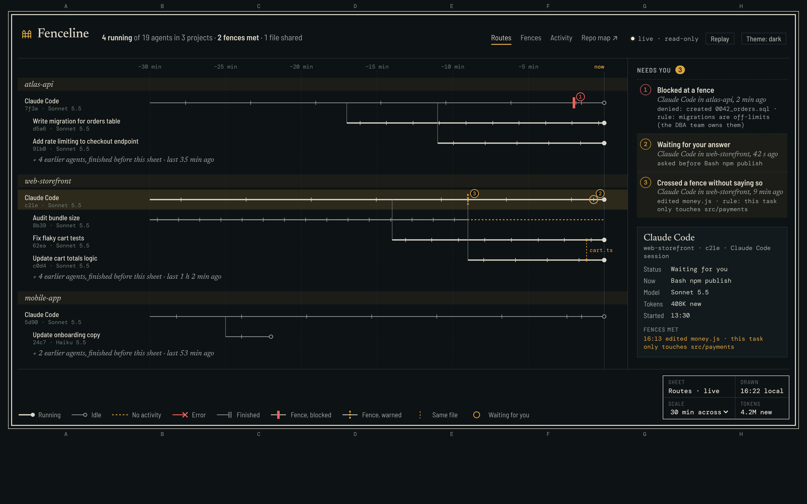
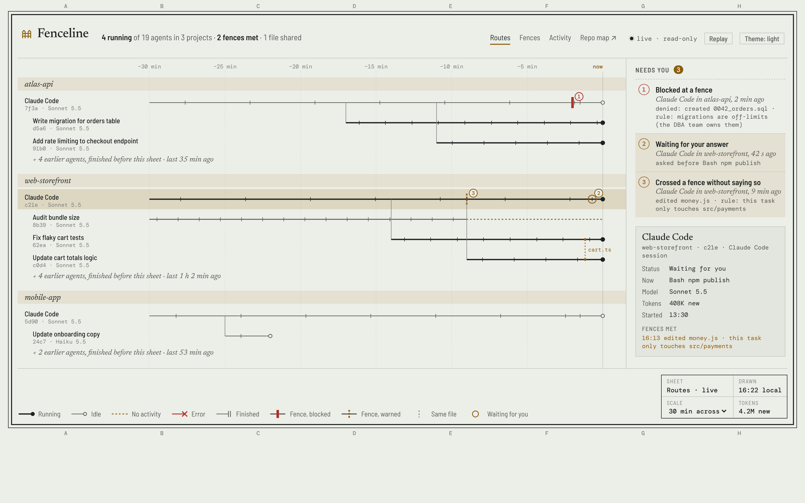
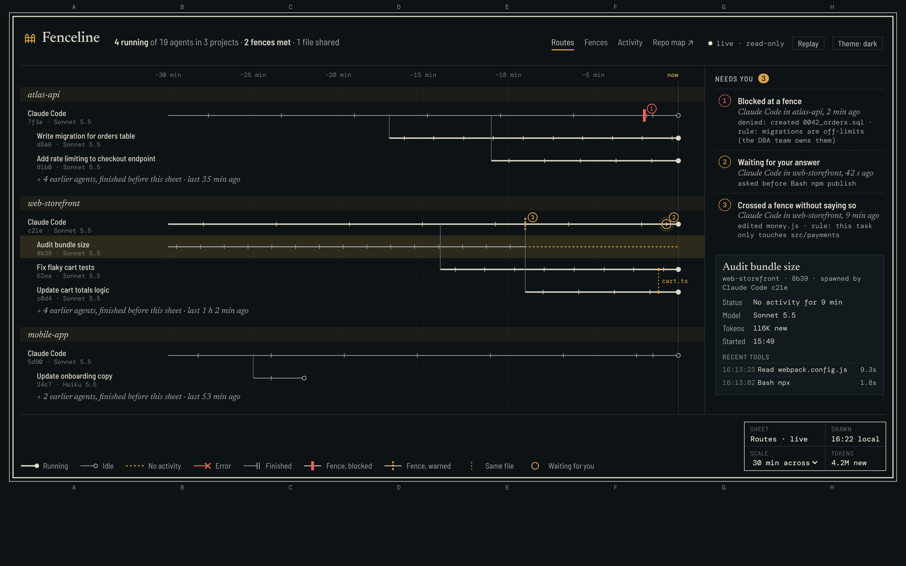
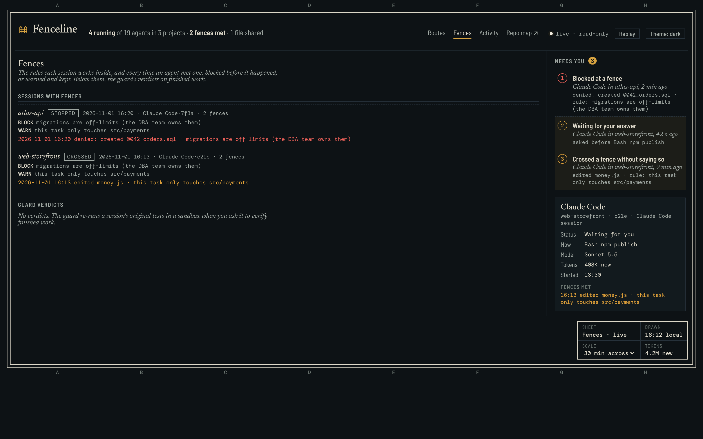
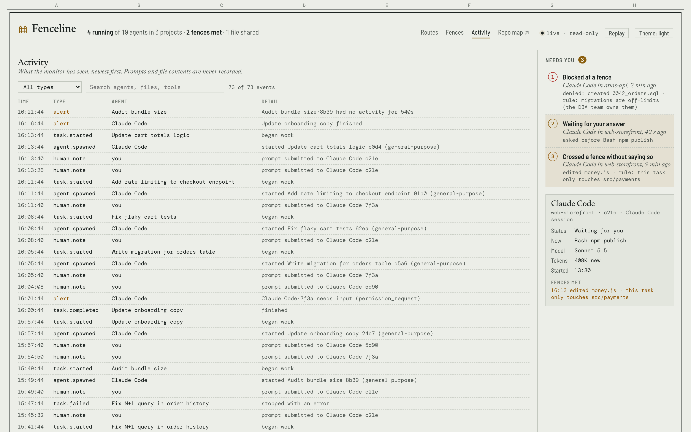
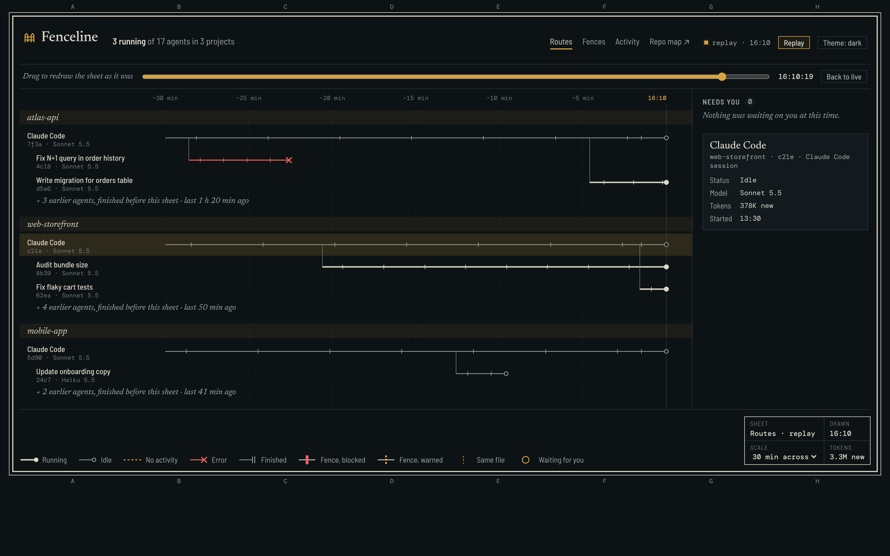
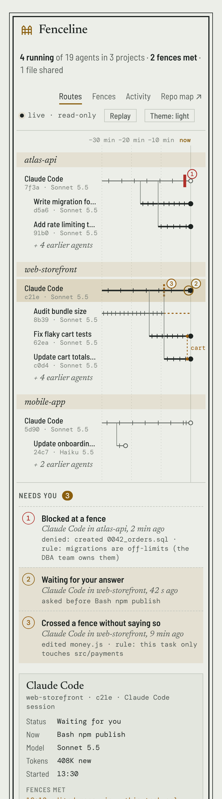
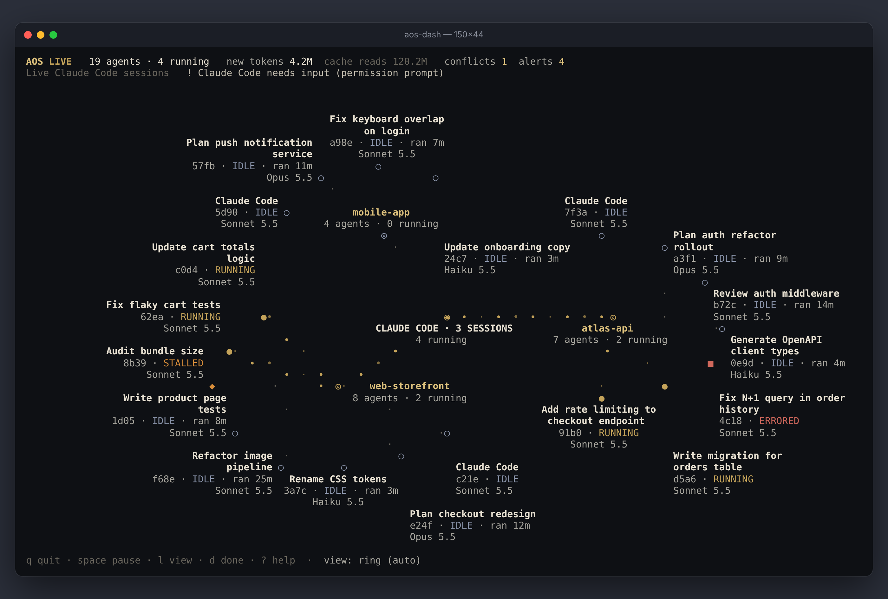

# Screenshots

All screenshots use a synthetic demo dataset (`scripts/demo-state.mjs`; no real projects or paths). Regenerate them with
`node scripts/screenshots.mjs` while the monitor runs.

<table>
<tr>
<td> Routes: agents over the last 30 minutes, fences where they were met, Needs you in the margin</td>
<td> The same sheet in the light theme</td>
</tr>
<tr>
<td> A selected route: its status, current tool, model, tokens and recent tools</td>
<td> Fences: each session's rules and every crossing, guard verdicts below</td>
</tr>
<tr>
<td> Activity: the event log, filterable and searchable</td>
<td> Replay: drag back and the sheet is redrawn as it was</td>
</tr>
<tr>
<td> Phone width</td>
<td> Terminal dashboard (<code>aos-dash</code>)</td>
</tr>
</table>
